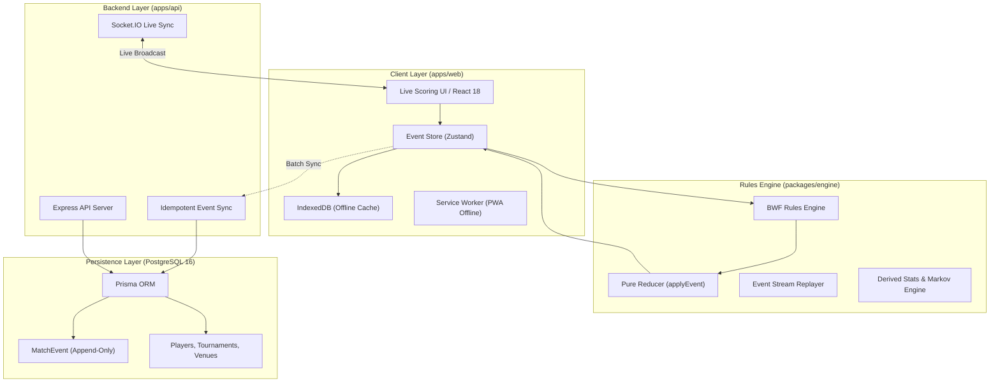
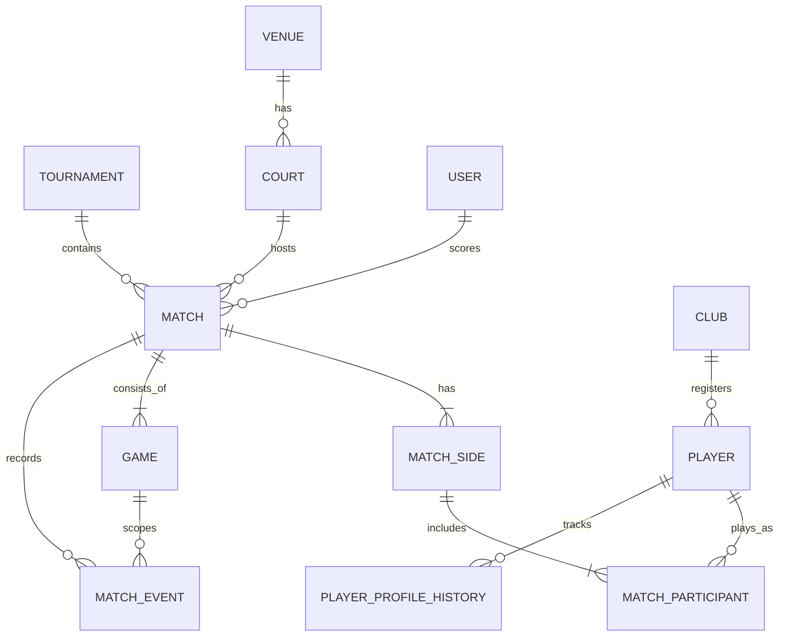

# RallyPoint

> Advanced Badminton Point-Tracking Web Application (PWA) built with an Event-Sourced architecture.

[](https://github.com/achudh2005/RallyPoint/actions/workflows/ci.yml)
[](https://github.com/achudh2005/RallyPoint)
[](LICENSE)

## Overview
RallyPoint is a tournament-grade badminton point tracking, analytics, and tournament management platform adhering strictly to Badminton World Federation (BWF) regulations. Built on an event-sourced architecture, match scores are never stored as mutable numbers; state is derived by pure reducers replaying append-only domain events.

---

## Architecture



---

## Monorepo Layout
- `packages/engine`: Pure TypeScript BWF rules and event-sourced scoring engine (zero runtime dependencies).
- `apps/web`: React 18 + Vite + Tailwind CSS + Zustand + Recharts + Dexie PWA.
- `apps/api`: Node.js + Express + TypeScript + Prisma + PostgreSQL 16 + Socket.IO.
- `packages/db`: Shared Prisma client and database repository schemas.

---

## Entity Relationship Overview



---

## Phases Summary

### Phase 1: Pure BWF Scoring Engine (`@rallypoint/engine`)
- Pure, immutable, event-sourced BWF scoring engine with zero external dependencies.
- Standard rally scoring to 21, win-by-2 deuce rule, and hard cap at 30 (29-29 golden point).
- Complete Singles and Doubles serve court calculation:
  - Singles: Server score parity dictates serving court (even = right, odd = left).
  - Doubles: Tracks individual player positions across left/right service courts. Position swaps occur exclusively when the serving side wins a rally. Receivers stay in place.
- Side changes at game boundaries and at 11 points in deciding games.
- Full event sourcing with undo support across game boundaries via event replay.
- Rich derived stats: longest streak, lead changes, comeback deficits, serve vs receive point win rates, pressure points (score 18+), and shot breakdown.
- 99.8% statement coverage, 91.4% branch coverage, and `fast-check` property tests proving state equivalence between incremental event application and complete event stream replay.

### Phase 2: Web App Core (`apps/web`)
- **Mobile-first, one-hand friendly live scoring screen**:
  - Match setup supporting Singles and Doubles, custom player names, configurable format (Best of 1, 3, or 5), initial server selection, and optional rally-end tagging toggle.
  - Giant interactive tap targets for each court end, dynamically adjusting to side swaps.
  - Haptic feedback integration (`navigator.vibrate`) on scoring and undo.
  - Real-time Court View rendering the active service court (right/left) and receiver positions with animated shuttlecock badges.
  - Optional rally-end tagging drawer (Smash, Drop, Net, Out, Unforced Error, Service Fault).
  - Full point-by-point log with rally tags and game transition history.
  - Match summary view with winner celebration, per-game breakdown, and streak metrics.
- **Local Persistence with IndexedDB (Dexie)**:
  - Automatic persistence to `RallyPointDB`. Matches survive browser refreshes and crashes with full event-sourced replay recovery.
- **Accessibility & UX**:
  - Dark and Light theme toggle.
  - Large-text mode for referees and court visibility.
  - Screen reader accessibility with dynamic `aria-live="polite"` score announcements.
  - Fast keyboard shortcuts: `A`/`1` (Side A), `B`/`2` (Side B), `U`/`Backspace` (Undo), `S` (Service Fault), `I` (Interval).
- **Automated Testing**:
  - Vitest + React Testing Library component tests.
  - Playwright end-to-end (e2e) test verifying complete match lifecycle.

### Phase 3: Analytics and Insights
- **Match Dashboard & Visual Analytics (Recharts)**:
  - **Momentum Chart**: Dynamic point-difference timeline showing rally-by-rally lead swings, zero baseline, and game boundaries.
  - **Win-Probability Curve**: Full Bayesian / Markov chain model predicting live game and match win probabilities from any score state.
  - **Score Progression Chart**: Cumulative point trajectories for both sides across games.
  - **Pressure Points Tracker**: Clutch performance analytics measuring win rates when scores reach 18+.
  - **Serve vs. Receive Conversion**: Statistical breakdown of points won on own serve versus receiving.
  - **Shot-Type Breakdown**: Granular distribution of winners and unforced errors (Smash, Drop, Net, Out, Unforced Error, Service Fault).
- **Player Profiles & Head-to-Head**:
  - Head-to-head records across historical matches stored in local database.
  - Form trend tracker displaying results of the last 10 matches (W/L badges).
- **Export & Sharing Capabilities**:
  - **Shareable Scorecard**: Branded 9:16 high-resolution scorecard sized for Instagram and WhatsApp stories, exported as a PNG image (`html-to-image`).
  - **Data Export**: Full match CSV export and structured JSON export for archival and external analysis.

### Phase 4: Backend, Auth, and Live Sync (`apps/api`)
- **Backend Architecture**:
  - Node.js + Express + TypeScript with Prisma ORM connecting to PostgreSQL 16.
  - Schemas: `User`, `Player`, `PlayerProfileHistory`, `Club`, `Team`, `TeamMember`, `Venue`, `Court`, `Tournament`, `Match`, `MatchSide`, `MatchParticipant`, `Game`, `MatchEvent`.
- **Security & Multi-Role Authentication**:
  - JWT Access Tokens (15m) and Refresh Tokens (7d) with bcrypt hashing.
  - Role-based authorization: `ADMIN`, `SCORER` (write match events), `UMPIRE` (can override match state), `PLAYER`, `VIEWER` (read-only).
  - Helmet security headers, CORS origin protection, and express-rate-limit protection.
- **Offline-First Synchronization**:
  - Idempotent event batch sync (`POST /api/matches/:id/events/sync`) accepting client-generated UUIDs with conflict resolution by event sequence ordering.
- **Real-Time Live Scoreboard**:
  - Socket.IO rooms per match (`/match` namespace) broadcasting live point events and spectator counts.
  - Public big-screen TV scoreboard endpoint (`/api/matches/:id/live`).
- **Developer Tooling & DevOps**:
  - OpenAPI 3.0 / Swagger UI documentation at `/api/docs`.
  - Docker Compose for local PostgreSQL 16 and pgAdmin 4.
  - Supertest API integration tests.

### Phase 5: Tournaments, PWA, and Production Polish
- **Tournament Manager**:
  - Single Elimination Knockout bracket generator with power-of-2 balancing and bye allocation.
  - Round Robin tournament scheduling algorithm.
  - BWF official tiebreakers (Matches Won > Head-to-Head > Game Differential > Point Differential).
  - Court allocation engine dispatching matches across available court slots.
- **Progressive Web App (PWA)**:
  - Web App Manifest (`manifest.json`) with badminton shuttlecock branding and standalone display mode.
  - Cache-first Service Worker (`sw.js`) for full offline scoring without internet connectivity.
  - React `ErrorBoundary` wrapper with crash recovery fallbacks.
- **Production Polish & DevOps**:
  - Structured JSON logging (`apps/api/src/utils/logger.ts`) for distributed tracing and observability.
  - Multi-stage production `Dockerfile.api` and `Dockerfile.web`.
  - Integrated `docker-compose.yml` spinning up PostgreSQL, pgAdmin, API, and Web containers.
  - Automated GitHub Actions CI pipeline (`.github/workflows/ci.yml`).
  - Deployment configurations for Vercel SPA (`apps/web/vercel.json`) and Render Cloud (`render.yaml`).
  - Vite vendor chunk splitting optimization (`recharts`, `dexie`, `html-to-image`).

---

## Getting Started

### Prerequisites
- Node.js 20+
- PostgreSQL 16 (or Docker)

### Installation
```bash
git clone git@github.com:achudh2005/RallyPoint.git
cd RallyPoint
npm install
```

### Local Development
```bash
# Start PostgreSQL & pgAdmin
docker compose up postgres pgadmin -d

# Generate Prisma client & run database migrations
npm run prisma:generate --workspace=@rallypoint/api

# Start API dev server (port 4000)
npm run dev --workspace=@rallypoint/api

# Start Web dev server (port 3000)
npm run dev --workspace=@rallypoint/web
```

### Running Tests & Quality Gate
```bash
# Typecheck all workspaces
npm run typecheck

# Run all test suites
npm run test

# Build production assets
npm run build
```
