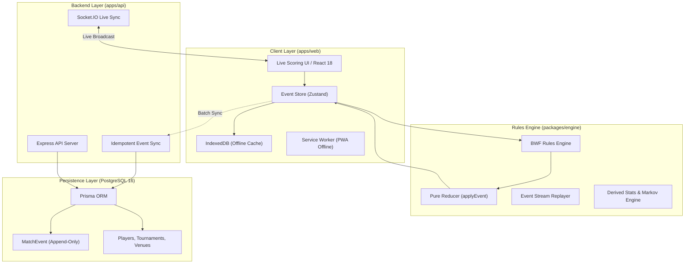
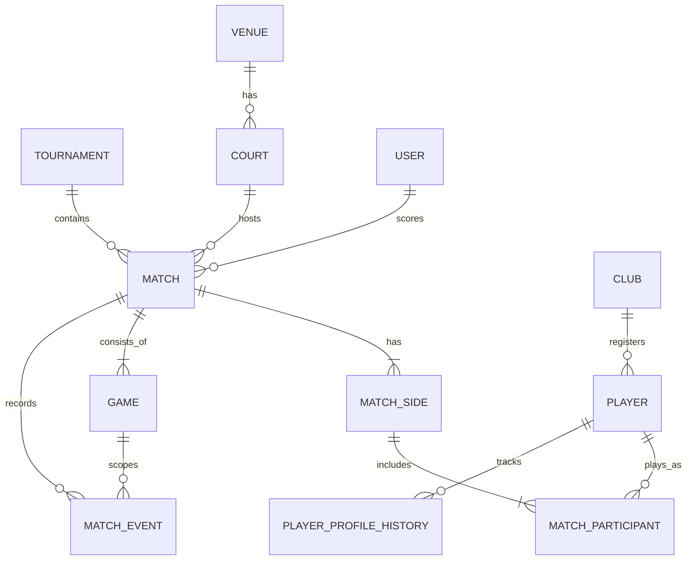

# RallyPoint

> Advanced Badminton Point-Tracking Web Application (PWA) built with an Event-Sourced architecture.

[](https://github.com/achudh2005/RallyPoint/actions/workflows/ci.yml)
[](https://github.com/achudh2005/RallyPoint)
[](LICENSE)

## Overview
RallyPoint is a tournament-grade badminton point tracking, analytics, and tournament management platform adhering strictly to Badminton World Federation (BWF) regulations. Built on an event-sourced architecture, match scores are never stored as mutable numbers; state is derived by pure reducers replaying append-only domain events.

RallyPoint is packaged as both a Progressive Web App (PWA) and a native Android application (APK) via Capacitor, optimized for modern high-refresh devices such as the iQOO Neo 10 (Android 15, Snapdragon 8 Gen 3 class, 144Hz AMOLED).

---

## Android Mobile App (Capacitor)
- **Application ID**: `com.rallypoint.app`
- **Target OS**: Android 15 (`compileSdk 35`, `targetSdk 35`, `minSdk 26`)
- **Target Device**: iQOO Neo 10 (Android 15, Funtouch OS / OriginOS, Snapdragon 8 Gen 3 class, 144Hz AMOLED)
- **ABIs Supported**: `arm64-v8a`, `armeabi-v7a`
- **Native Hardware Optimizations**:
  - Edge-to-edge layout with punch-hole camera cutout handling (`shortEdges`)
  - 120Hz & 144Hz display mode preference for ultra-fluid courtside scoring
  - Linear vibration motor haptics (distinct impact intensities for points, undo, side change, and victory)
  - Screen Keep-Awake during active rallies
  - Android 13+ predictive back gesture & modal back navigation stack
  - Funtouch OS battery optimization guide modal
  - Event-sourced mid-match crash recovery from IndexedDB
  - Android native share sheet integration for match results and event logs
- **Cloud Build**: Built headlessly via GitHub Actions without requiring local Android Studio.

### Cloud APK Signing & Keystore Setup
To configure production release signing for future updates:
1. Run the generation script once in any terminal with Java (e.g. GitHub Codespace, Mac, Linux):
   ```bash
   bash scripts/generate-keystore.sh
   ```
2. Base64 encode the generated `rallypoint-release.keystore`:
   - **Linux/macOS**: `base64 -w 0 rallypoint-release.keystore > keystore_base64.txt`
   - **Windows PowerShell**: `[Convert]::ToBase64String([IO.File]::ReadAllBytes('rallypoint-release.keystore')) | Out-File keystore_base64.txt`
3. Add the following repository secrets under **GitHub Repository Settings > Secrets and variables > Actions**:
   - `ANDROID_KEYSTORE_BASE64`: Contents of `keystore_base64.txt`
   - `ANDROID_KEYSTORE_PASSWORD`: Keystore password you entered
   - `ANDROID_KEY_ALIAS`: `rallypoint`
   - `ANDROID_KEY_PASSWORD`: Key password you entered
4. *Note: If repository secrets are not set, the GitHub Actions cloud build falls back to debug signing automatically so testing is never blocked.*
⚠️ **CRITICAL**: Back up `rallypoint-release.keystore` and passwords securely. If lost, future updates cannot be installed over existing installs without reinstalling.
- **Key Mobile Scripts**:
  - `npm run build:web` - Compiles TypeScript and builds the Vite production SPA
  - `npm run cap:sync` - Syncs web bundle and native plugins to the `android/` project
  - `npm run android:debug` - Assembles debug APK locally or in CI
  - `npm run android:release` - Assembles release APK with R8 shrinking and ProGuard optimization

---

## Architecture



---

## Monorepo Layout
- `packages/engine`: Pure TypeScript BWF rules and event-sourced scoring engine (zero runtime dependencies).
- `packages/scoring-rules`: Pure TypeScript scoring format engine supporting BWF Rally Point (21, 15, 11) and Traditional Service Point (15, 11, One Down doubles serve rule, setting choices at 13/14-all or 9/10-all).
- `packages/ranking`: Pure TypeScript ranking & team league engine with Ranking Points (RP), format filtering, and zero dependencies (96%+ test coverage).
- `packages/ui`: Apple HIG design system with SF Pro typography, dynamic accent colors, iOS materials, haptics, and accessible components.
- `apps/web`: React 18 + Vite + Tailwind CSS + Zustand + Recharts + Dexie PWA.
- `apps/api`: Node.js + Express + TypeScript + Prisma + PostgreSQL 16 + Socket.IO.
- `packages/db`: Shared Prisma client and database repository schemas.

---

## Native Apple Design System & UI Redesign (`@rallypoint/ui` & `apps/web`)

RallyPoint features an Apple Human Interface Guidelines (HIG) front-end interface built with React 18, Vite, TypeScript, Tailwind CSS, Zustand, Recharts, and Framer Motion:

### Key Design Pillars
1. **One Screen, One Job**: Every screen has a single prominent primary action and zero visual clutter.
2. **Progressive Disclosure**: Advanced options (shot tagging, point details, custom scoring limits) are cleanly deferred to bottom sheets and settings.
3. **Calm Courtside Scoring (`AppleScoringScreen.tsx`)**:
   - Split-screen interface: two massive tappable halves (portrait top/bottom, landscape left/right).
   - High-contrast rolling score digits (`ScoreNumberRoll`) with smooth physics.
   - Haptic feedback on every point scored (`Haptics.pointScored()`) and undo (`Haptics.undo()`).
   - Screen Wake Lock to prevent timeout during court action.
   - Global keyboard shortcuts (`ArrowUp`/`ArrowDown`/`1`/`2` to score, `u`/`Backspace` for undo, `s`/`d`/`n` to tag shots).
4. **4-Tab Native Bottom Navigation (`TabBar.tsx`)**:
   - `Play`: Hero "Start Match", active match card for 1-tap live resumption, and recent matches list.
   - `Rankings`: Large title, segmented player vs team toggle, category chips, 🥇 elevated podium, and standings list.
   - `Players`: Searchable roster, avatar initials, match counts, and "Add Player" modal.
   - `Profile`: Inset iOS Settings with Dark Appearance, 5 Apple accent colors (`green`, `blue`, `teal`, `indigo`, `amber`), haptics toggle, ranking rebuilder, event export, and component showcase.
5. **Onboarding & Celebration**:
   - 3-card swipeable welcome sheet introducing quick scoring, service rules, and live rankings.
   - Fullscreen canvas particle confetti explosion on match completion.
6. **Stadium TV Scoreboard (`TVScoreboardScreen.tsx`)**:
   - High-visibility arena display designed for public gym TVs and projectors with 120-220pt digit counters and fullscreen toggle.




---

## Phases Summary

### Phase 1: Pure BWF Scoring Engine (`@rallypoint/engine`)
- Pure, immutable, event-sourced BWF scoring engine with zero external dependencies.
- Standard rally scoring to 21, win-by-2 deuce rule, and hard cap at 30 (29-29 golden point).
- Complete Singles and Doubles serve court calculation:
  - Singles: Server score parity dictates serving court (even = right, odd = left).
  - Doubles: Tracks individual player positions across left/right service courts. Position swaps occur exclusively when the serving side wins a rally. Receivers stay in place.
- Side changes at game boundaries and at 11 points in deciding games.
- Full event sourcing with undo support across game boundaries via event replay.
- Rich derived stats: longest streak, lead changes, comeback deficits, serve vs receive point win rates, pressure points (score 18+), and shot breakdown.
- 99.8% statement coverage, 91.4% branch coverage, and `fast-check` property tests proving state equivalence between incremental event application and complete event stream replay.

### Phase 2: Web App Core (`apps/web`)
- **Mobile-first, one-hand friendly live scoring screen**:
  - Match setup supporting Singles and Doubles, custom player names, configurable format (Best of 1, 3, or 5), initial server selection, and optional rally-end tagging toggle.
  - Giant interactive tap targets for each court end, dynamically adjusting to side swaps.
  - Haptic feedback integration (`navigator.vibrate`) on scoring and undo.
  - Real-time Court View rendering the active service court (right/left) and receiver positions with animated shuttlecock badges.
  - Optional rally-end tagging drawer (Smash, Drop, Net, Out, Unforced Error, Service Fault).
  - Full point-by-point log with rally tags and game transition history.
  - Match summary view with winner celebration, per-game breakdown, and streak metrics.
- **Local Persistence with IndexedDB (Dexie)**:
  - Automatic persistence to `RallyPointDB`. Matches survive browser refreshes and crashes with full event-sourced replay recovery.
- **Accessibility & UX**:
  - Dark and Light theme toggle.
  - Large-text mode for referees and court visibility.
  - Screen reader accessibility with dynamic `aria-live="polite"` score announcements.
  - Fast keyboard shortcuts: `A`/`1` (Side A), `B`/`2` (Side B), `U`/`Backspace` (Undo), `S` (Service Fault), `I` (Interval).
- **Automated Testing**:
  - Vitest + React Testing Library component tests.
  - Playwright end-to-end (e2e) test verifying complete match lifecycle.

### Phase 3: Analytics and Insights
- **Match Dashboard & Visual Analytics (Recharts)**:
  - **Momentum Chart**: Dynamic point-difference timeline showing rally-by-rally lead swings, zero baseline, and game boundaries.
  - **Win-Probability Curve**: Full Bayesian / Markov chain model predicting live game and match win probabilities from any score state.
  - **Score Progression Chart**: Cumulative point trajectories for both sides across games.
  - **Pressure Points Tracker**: Clutch performance analytics measuring win rates when scores reach 18+.
  - **Serve vs. Receive Conversion**: Statistical breakdown of points won on own serve versus receiving.
  - **Shot-Type Breakdown**: Granular distribution of winners and unforced errors (Smash, Drop, Net, Out, Unforced Error, Service Fault).
- **Player Profiles & Head-to-Head**:
  - Head-to-head records across historical matches stored in local database.
  - Form trend tracker displaying results of the last 10 matches (W/L badges).
- **Export & Sharing Capabilities**:
  - **Shareable Scorecard**: Branded 9:16 high-resolution scorecard sized for Instagram and WhatsApp stories, exported as a PNG image (`html-to-image`).
  - **Data Export**: Full match CSV export and structured JSON export for archival and external analysis.

### Phase 4: Backend, Auth, and Live Sync (`apps/api`)
- **Backend Architecture**:
  - Node.js + Express + TypeScript with Prisma ORM connecting to PostgreSQL 16.
  - Schemas: `User`, `Player`, `PlayerProfileHistory`, `Club`, `Team`, `TeamMember`, `Venue`, `Court`, `Tournament`, `Match`, `MatchSide`, `MatchParticipant`, `Game`, `MatchEvent`.
- **Security & Multi-Role Authentication**:
  - JWT Access Tokens (15m) and Refresh Tokens (7d) with bcrypt hashing.
  - Role-based authorization: `ADMIN`, `SCORER` (write match events), `UMPIRE` (can override match state), `PLAYER`, `VIEWER` (read-only).
  - Helmet security headers, CORS origin protection, and express-rate-limit protection.
- **Offline-First Synchronization**:
  - Idempotent event batch sync (`POST /api/matches/:id/events/sync`) accepting client-generated UUIDs with conflict resolution by event sequence ordering.
- **Real-Time Live Scoreboard**:
  - Socket.IO rooms per match (`/match` namespace) broadcasting live point events and spectator counts.
  - Public big-screen TV scoreboard endpoint (`/api/matches/:id/live`).
- **Developer Tooling & DevOps**:
  - OpenAPI 3.0 / Swagger UI documentation at `/api/docs`.
  - Docker Compose for local PostgreSQL 16 and pgAdmin 4.
  - Supertest API integration tests.

### Phase 5: Tournaments, PWA, and Production Polish
- **Tournament Manager**:
  - Single Elimination Knockout bracket generator with power-of-2 balancing and bye allocation.
  - Round Robin tournament scheduling algorithm.
  - BWF official tiebreakers (Matches Won > Head-to-Head > Game Differential > Point Differential).
  - Court allocation engine dispatching matches across available court slots.
- **Progressive Web App (PWA)**:
  - Web App Manifest (`manifest.json`) with badminton shuttlecock branding and standalone display mode.
  - Cache-first Service Worker (`sw.js`) for full offline scoring without internet connectivity.
  - React `ErrorBoundary` wrapper with crash recovery fallbacks.
- **Production Polish & DevOps**:
  - Structured JSON logging (`apps/api/src/utils/logger.ts`) for distributed tracing and observability.
  - Multi-stage production `Dockerfile.api` and `Dockerfile.web`.
  - Integrated `docker-compose.yml` spinning up PostgreSQL, pgAdmin, API, and Web containers.
  - Automated GitHub Actions CI pipeline (`.github/workflows/ci.yml`).
  - Deployment configurations for Vercel SPA (`apps/web/vercel.json`) and Render Cloud (`render.yaml`).
  - Vite vendor chunk splitting optimization (`recharts`, `dexie`, `html-to-image`).

---

## Production Database Architecture (`@rallypoint/db`)

For complete details, see [docs/database.md](docs/database.md).

- **DB Phase 1: Core Schema & Master Data (3NF)**:
  - Master entities: User, Player, Club, Team, Venue, Court, Tournament.
  - Historical audit snapshots via `PlayerProfileHistory` and soft deletes (`deleted_at`).
  - Realistic seed script (`packages/db/src/seed.ts`).
- **DB Phase 2: Append-Only Event History**:
  - Strict append-only `match_events` with database exception triggers preventing `UPDATE` or `DELETE`.
  - Declarative monthly partitioning on `occurred_at` (`packages/db/src/partitioning.sql`).
  - Idempotent event ingestion service (`packages/db/src/eventIngestion.ts`).
- **DB Phase 3: Derived Analytics Layer & Rollups**:
  - Fast-read rollup tables: `PlayerCareerStats`, `HeadToHead`, `PlayerFormTrend`, `MatchAnalyticsRollup`.
  - Stored procedures (`rebuild_player_stats`) and match completion triggers (`trg_match_completed_rollups`).
- **DB Phase 4: Production Hardening, Performance & Operations**:
  - Backup & restore automation (`scripts/backup.sh`, `scripts/restore.sh`, `scripts/archive_partitions.sh`).
  - PgBouncer high-concurrency transaction pooling (`packages/db/src/pgbouncer.ini`).
  - Row Level Security (RLS) policies (`packages/db/src/rlsPolicies.sql`).
  - Performance audit with `EXPLAIN ANALYZE` benchmarks (`packages/db/src/performanceAudit.sql`).
  - End-to-end 16-player tournament simulation and concurrent live scoring tests (`packages/db/src/dbE2E.test.ts`).

---

## Community Ranking and Team League System (`@rallypoint/ranking` & `apps/web`)

A dedicated pure TypeScript ranking engine and live marking interface for local badminton communities and leagues:
- **Event-Sourced Projections**: Recomputable from raw match events at any time with `npm run rebuild-rankings`.
- **Rally Event Tagging**: Attributed shot types (`SMASH`, `DROP`, `NET`, `CLEAR`, `DRIVE`, `LOB`, `SERVE`) and rally outcomes (`WINNER`, `UNFORCED_ERROR`, `FORCED_ERROR`, `OUT`, `NET_FAULT`, `SERVICE_FAULT`).
- **Live Mini-Leaderboard Strip**: Top 3 high-contrast live banner atop the scoring screen showing live points, rank movement arrows (`▲`, `▼`, `−`), gold/silver/bronze badges, and mandatory `Matches: N` indicators.
- **Quick-Mark Layer**:
  - Fat-finger chips for Shot Types and Winner / Error attribution.
  - Three tagging modes: `FAST` (0 extra taps, pure scoring), `QUICK` (3-second auto-dismiss chip row), `FULL` (stays until confirmed).
- **Point History & Correction**:
  - Review last 10 points in match history, correct shot types/winners, or perform safe undo with instant re-ranking.
- **Community Match Setup & Auto-Balanced Doubles**:
  - Community roster picker with instant search and recent player chips.
  - Balanced doubles pairing algorithm balancing skill ratings to minimize rank differential.
- **Leaderboards**:
  - `OVERALL`: Weighted composite index:
    $$\text{Score} = 0.40 \times \text{WinRate} + 0.25 \times \text{PtDiff} + 0.15 \times \text{Wins} + 0.10 \times \text{Form} + 0.10 \times \text{Consistency}$$
  - `MOST WINS`, `MOST POINTS SCORED`, `MOST LOSSES`, `MOST DROPS` (played & conceded), `MOST UNFORCED ERRORS`, and `BEST WIN RATE` (min matches filter).
- **Format Requirements**:
  - Every leaderboard row displays **Matches: N** next to rank.
  - Shared tie ranks `(1, 2, 2, 4)` and rank movements (`UP`, `DOWN`, `SAME`).
- **Rankings Dashboard (`RankingsDashboard.tsx`)**:
  - Live category leaderboards (Overall, Most Wins, Most Points, Most Losses, Drops Played/Conceded, Most Errors, Win Rate).
  - Multi-window time filtering: Season, Month, Week, All-time.
  - Weekly community accolades: Drop-Shot King, Iron Wall, Smash Master, Comeback Kid, Marathoner.
  - Social story card export (vertical 9:16 PNG) for Instagram/WhatsApp and full CSV export.
- **Player Profile Modal**: Inverted Y-axis rank history over time, shot winner/error radar & bar breakdowns, and head-to-head lookup against any opponent.
- **Team League**: Auto-detected doubles pairs and fixed club teams with promotion and relegation cutoff thresholds.
- **Backend & Live Sync (`apps/api` - Phase 4)**:
  - High-performance in-memory cache with 5s TTL & cache invalidation on new match events.
  - Endpoints: `GET /api/rankings/:category`, `GET /api/rankings/player/:id`, `GET /api/rankings/head-to-head`, `GET /api/teams/rankings`.
  - Live ranking updates via Socket.IO `/rankings` namespace with 500ms debounce emitting minimal diffs (`rankings:update`).
  - Admin controls (`/api/admin/rebuild-rankings`, `/api/admin/recalculate-streaks`, `/api/admin/audit-log`, `/api/admin/daily-rollup`) secured with JWT RBAC.
- **Polish, Performance & Deployment (Phase 5 / `rank-v1.0.0`)**:
  - Full technical documentation in [docs/ranking-system.md](docs/ranking-system.md).
  - Materialized views (`mv_player_rankings`, `mv_team_rankings`) with concurrent refresh trigger on match completion.
  - `EXPLAIN (ANALYZE, BUFFERS)` audit of 5 heaviest queries (`packages/db/src/rankingPerformanceAudit.sql`).
  - Synthetic load benchmark testing 200 players, 20,000 matches, and 1,000,000 events (`loadTest.ts`).
  - Realistic community seed script (`seedCommunityRankings.ts` / `npm run seed:community`) with 12 players, 4 teams, and 3 weeks of matches.
  - PWA offline caching via Dexie IndexedDB with offline banner indicator and queued event sync.
  - Color-blind-safe badges (`#1 Gold`, `#2 Silver`, `#3 Bronze`) and `aria-live="polite"` screen-reader accessibility.
  - Multi-stage Docker configuration supporting `@rallypoint/ranking`.
- **Scoring System Selection & Ranking Points (RP) Engine (`@rallypoint/scoring-rules` & `@rallypoint/ranking`)**:
  - **Scoring Formats Supported**:
    - `RALLY_21`: Standard BWF rally scoring (game to 21, win by 2, cap at 30, deciding game side change at 11).
    - `RALLY_15`: Short rally point format (game to 15, win by 2, cap at 21, deciding game side change at 8).
    - `RALLY_11`: Fast rally point sprint format (game to 11, win by 2, cap at 15, deciding game side change at 6).
    - `SERVICE_POINT_15`: Traditional service-only scoring. Only the serving side scores points; receiver winning the rally forces a Side-Out (0 points scored). Setting option at 13-all (set to 5, game to 18) and 14-all (set to 3, game to 17) awarded to the side reaching the score first. Deciding game switch at 8.
    - `SERVICE_POINT_11`: Traditional 11-point service scoring. Setting option at 9-all (set to 3, game to 14) and 10-all (set to 3, game to 13). Deciding game switch at 6.
    - `CUSTOM`: Configurable target points, win-by, cap, setting rules, and best-of length.
  - **Traditional Doubles "One Down" Rule**:
    - At the start of every game in service point scoring, the serving pair begins with only one server ("One Down"). Losing the rally immediately yields a side-out. Thereafter, both partners serve consecutively before each side-out.
  - **Ranking Points (RP) & League Standings**:
    - Win: 3 RP (Rally or Service Point).
    - Bonus points: +1 RP for straight-game wins (2-0), +1 RP for defeating a player ranked 3+ spots higher (Giant Killer), +1 RP for winning a game that went to setting.
    - Matches split display format: `Matches: N (R:X S:Y)`.
    - Normalization: When viewing all scoring systems together (`formatFilter === 'ALL'`), points scored ranking normalizes by `pointSharePct` ($\frac{\text{PointsScored}}{\text{TotalMatchPoints}} \times 100$) ensuring 15-pt and 21-pt games are evaluated fairly.
    - Service game leaderboards: `BEST_SERVICE_GAME` ranking players by service holds, side-outs won, and service points won.
  - **Live Marking UI While Playing (`apps/web` - Phase 2)**:
    - Match setup with prominent Scoring System Picker (Rally 21, Rally 15, Rally 11, Service 15, Service 11, Custom) with localStorage memory.
    - Coin Toss Helper (`🪙 Toss`) for random first server selection.
    - Adaptive Scoring Screen with prominent `⚡ SERVICE POINT SCORING` banner, active server callout, and doubles One Down / Server 1 of 2 badge.
    - Adaptive button prediction badges: `+1 POINT` for server side, `SIDE OUT` / `SECOND SERVER` for receiver side.
    - Setting Choice Modal on setting thresholds (13-all / 14-all, 9-all / 10-all) prompting the eligible side to set or play on.
    - 3-second auto-dismiss Quick-Mark detail bar for fast shot attribution and full undo across side-outs and points.

  - **Native Apple UI Redesign (Apple Human Interface Guidelines)**:
    - **Design System (`@rallypoint/ui`)**: Tokens, typography (SF Pro scale), light & dark themes, customizable accent colors, Dynamic Type sizing, haptics engine, and interactive Component Gallery.
    - **4-Tab Navigation & Play Screen**: Liquid glass tab bar (`Play`, `Rankings`, `Players`, `Profile`), single-hero "Start Match" button, and active match resumption banner.
    - **3-Step Match Setup Sheet**: Progressive disclosure for player selection, "Fair Teams" balanced doubles auto-pairing, scoring system selection, and coin-flip toss.
    - **Calm Apple Live Scoring**: Distraction-free high-contrast split-screen scoring, rolling digit counters (`ScoreNumberRoll`), quiet Undo, Service Point rules, and screen wake lock.

  - **Database Architecture & Operations (Phases 1 - 4 - Production Grade)**:
    - **Master Data Layer (3NF)**: Users, Players (with pg_trgm fuzzy search & FTS), Clubs, Teams, Members, Venues, Courts, Tournaments, Seasons.
    - **Append-Only Event Layer**: Declarative monthly partitioned `match_events` table on `occurred_at`, strictly blocking UPDATE/DELETE via database triggers, with client-UUID idempotent ingestion.
    - **Continuous Derived Layer**: Recomputable stats (`player_career_stats`, `head_to_head_stats`, `player_form_trends`, `match_analytics_rollups`, `player_ranking_snapshots`), completely reconstructible via `npm run db:rebuild-stats`.
    - **Data Safety, GDPR & Audit**: Automated change data capture (`audit_logs`), Row-Level Security (RLS) policies, GDPR personal data scrubbing (`anonymizePlayer`), and full JSON dossier export (`exportPlayerData`).
    - **Repository & Service Layer (`packages/db`)**: Fully typed repository with Zod validation and cursor-based pagination on all list queries.
    - **Database Documentation**: Detailed ERD in Mermaid ([/docs/erd.md](docs/erd.md)), comprehensive Data Dictionary ([/docs/data-dictionary.md](docs/data-dictionary.md)), and Migration Guide ([/docs/migration-guide.md](docs/migration-guide.md)).
    - **Performance & Benchmarks**: 10 critical EXPLAIN ANALYZE queries audited, PgBouncer pooling config, and synthetic load generator for 100k players and 5M events.

---

## Getting Started

### Prerequisites
- Node.js 20+
- PostgreSQL 16 (or Docker)

### Installation
```bash
git clone git@github.com:achudh2005/RallyPoint.git
cd RallyPoint
npm install
```

### Local Development
```bash
# Start PostgreSQL & pgAdmin
docker compose up postgres pgadmin -d

# Generate Prisma client & run database migrations
npm run prisma:generate --workspace=@rallypoint/api

# Start API dev server (port 4000)
npm run dev --workspace=@rallypoint/api

# Start Web dev server (port 3000)
npm run dev --workspace=@rallypoint/web
```

### Running Tests & Quality Gate
```bash
# Typecheck all workspaces
npm run typecheck

# Run all test suites
npm run test

# Build production assets
npm run build
```
