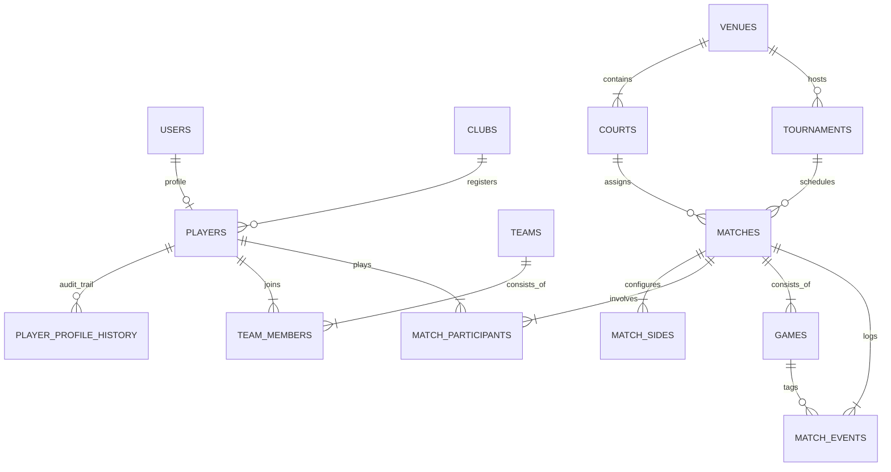

# RallyPoint Database Architecture & Specification

## Overview
This document specifies the PostgreSQL 16 database design for **RallyPoint**, an advanced badminton tournament and match tracking platform with an event-sourced core and high-performance analytics read layer.

---

## 3-Layer Design Principles
1. **Layer 1: Master Data (3NF)**:
   - Core domain entities: `User`, `Player`, `Club`, `Team`, `Venue`, `Court`, `Tournament`.
   - Strict referential integrity, foreign key cascades, and unique constraints.
   - Soft deletes (`deleted_at`) for audit compliance and historical reference.
   - Historical audit tracking via `PlayerProfileHistory` snapshots.
2. **Layer 2: Append-Only Event History**:
   - `MatchEvent` is strictly append-only.
   - Mutations and deletions are forbidden at the database level.
   - Any score adjustment or reversal occurs via explicit compensating events (`UNDO`, `POINT`).
   - Partitioned by month on `occurred_at` for high query throughput and scalable data archiving.
3. **Layer 3: Derived & Materialized Analytics**:
   - Recomputable rollups: `PlayerCareerStats`, `HeadToHead`, `PlayerFormTrend`, `MatchAnalyticsRollup`.
   - Guaranteed idempotency: Any derived table can be fully reconstructed by replaying Layer 2 events.

---

## Master Data Entity Relationship Diagram

---

## Master Data Tables & Constraints

### 1. `users`
- `id`: CUID / UUID v7 Primary Key.
- `email`: VARCHAR(255) UNIQUE NOT NULL.
- `password_hash`: VARCHAR(255) NOT NULL (bcrypt).
- `role`: ENUM ('ADMIN', 'SCORER', 'UMPIRE', 'PLAYER', 'VIEWER') NOT NULL.
- `is_active`: BOOLEAN DEFAULT true.

### 2. `players`
- `id`: CUID Primary Key.
- `user_id`: CUID NULLABLE UNIQUE (FK -> users.id ON DELETE SET NULL).
- `first_name`, `last_name`: VARCHAR(100) NOT NULL.
- `display_name`: VARCHAR(200) NOT NULL.
- `dominant_hand`: ENUM ('LEFT', 'RIGHT') NULLABLE.
- `club_id`: CUID NULLABLE (FK -> clubs.id ON DELETE SET NULL).
- `status`: ENUM ('ACTIVE', 'INACTIVE', 'RETIRED') DEFAULT 'ACTIVE'.
- `external_ids`: JSONB (stores BWF ID, state IDs).
- `deleted_at`: TIMESTAMP WITH TIME ZONE NULLABLE (Soft delete).

### 3. `player_profile_history`
- `id`: CUID Primary Key.
- `player_id`: CUID NOT NULL (FK -> players.id ON DELETE CASCADE).
- `snapshot`: JSONB NOT NULL.
- `changed_by`: VARCHAR(100) NOT NULL.
- `changed_at`: TIMESTAMP WITH TIME ZONE DEFAULT NOW().

### 4. `clubs`
- `id`: CUID Primary Key.
- `name`: VARCHAR(200) NOT NULL.
- `city`: VARCHAR(100).
- `logo_url`: TEXT.
- `deleted_at`: TIMESTAMP WITH TIME ZONE NULLABLE.

### 5. `teams` & `team_members`
- Supports Singles entries, Doubles pairs, and Club teams.
- Active membership unique constraint: `UNIQUE(team_id, player_id, left_at)`.

### 6. `venues` & `courts`
- Multi-court support per venue with unique constraint on `(venue_id, court_number)`.

### 7. `tournaments`
- Formats: `KNOCKOUT`, `ROUND_ROBIN`, `GROUP_KNOCKOUT`.
- Categories: `MS` (Men's Singles), `WS` (Women's Singles), `MD` (Men's Doubles), `WD` (Women's Doubles), `XD` (Mixed Doubles).

---

## Indexing Strategy
- **Fuzzy Search**: `CREATE INDEX idx_players_trgm ON players USING gin (lower(display_name) gin_trgm_ops);`
- **Full Text Search**: GIN index on `to_tsvector('english', first_name || ' ' || last_name)`
- **Foreign Keys**: B-Tree indexes on all foreign key columns (`club_id`, `venue_id`, `tournament_id`, `match_id`).

---

## Phase 2: Append-Only Event Layer & Partitioning

### 1. `matches` & `games`
- Matches store tournament and court references, scorer UUID, format configuration (`best_of`), and unique `client_uuid` for idempotent match creation.
- Games enforce valid badminton game numbers and track current scores with foreign key cascade from matches.

### 2. `match_events` Append-Only Table
- Stores granular domain events: `POINT`, `UNDO`, `SERVE_FAULT`, `INTERVAL`, `RETIRE`, `WALKOVER`, `GAME_END`, `MATCH_END`.
- Unique constraint on `(match_id, sequence_number)` guarantees strict sequence progression.
- Database trigger `enforce_match_events_append_only()` raises an exception on any `UPDATE` or `DELETE`.
- Monthly partitioning on `occurred_at`:
  - `create_monthly_match_events_partition(target_date)` dynamically creates monthly child tables `match_events_YYYY_MM`.
  - `ensure_future_match_event_partitions(6)` pre-creates partitions for the next 6 months.

### 3. Idempotent Ingestion Engine (`eventIngestion.ts`)
- Client-generated UUIDs ensure retry-safe ingestion.
- Strict sequence number validation prevents sequence gaps and out-of-order writes.
