# RallyPoint Database Entity Relationship Diagram (ERD)

This document provides a comprehensive entity relationship model of the RallyPoint PostgreSQL 16 database, illustrating all tables across **Layer 1 (Master Data)**, **Layer 2 (Append-Only Event Sourcing)**, and **Layer 3 (Derived Analytics & Snapshots)**.

---

## 1. Complete Entity Relationship Diagram (Mermaid)

```mermaid
erDiagram
    users ||--o| players : "has profile"
    users ||--o{ matches : "scores"
    clubs ||--o{ players : "registers"
    players ||--o{ player_profile_history : "tracks changes"
    teams ||--|{ team_members : "comprises"
    players ||--|{ team_members : "belongs to"
    venues ||--|{ courts : "houses"
    venues ||--o{ tournaments : "hosts"
    tournaments ||--o{ matches : "schedules"
    seasons ||--o{ matches : "organizes"
    courts ||--o{ matches : "hosts match"
    matches ||--|{ match_sides : "configures"
    teams ||--o{ match_sides : "competes as"
    matches ||--|{ match_participants : "involves"
    players ||--|{ match_participants : "plays in"
    matches ||--|{ games : "consists of"
    matches ||--|{ match_events : "records"
    games ||--o{ match_events : "indexes"
    matches ||--o| match_analytics_rollups : "derives"
    players ||--o| player_career_stats : "aggregates"
    players ||--o| player_form_trends : "tracks trend"
    players ||--o{ player_ranking_snapshots : "evaluated in"
    seasons ||--o{ player_ranking_snapshots : "scoped by"
    teams ||--o{ team_ranking_snapshots : "ranked in"
    seasons ||--o{ team_ranking_snapshots : "scoped by"

    users {
        string id PK
        string email UK
        string password_hash
        enum role "ADMIN | SCORER | PLAYER | VIEWER | UMPIRE"
        boolean is_active
        datetime last_login_at
        datetime created_at
        datetime updated_at
    }

    players {
        string id PK
        string user_id FK,UK "Nullable, SetNull"
        string first_name
        string last_name
        string display_name "Indexed with pg_trgm"
        datetime date_of_birth
        string gender
        string nationality
        enum dominant_hand "LEFT | RIGHT"
        int height_cm
        int weight_kg
        string photo_url
        string bio
        string phone
        string email
        string city
        string state
        string country
        string club_id FK "Nullable, SetNull"
        enum status "ACTIVE | INACTIVE | RETIRED"
        jsonb external_ids "BWF, State IDs"
        datetime deleted_at "Soft delete"
        datetime created_at
        datetime updated_at
    }

    player_profile_history {
        string id PK
        string player_id FK "Cascade"
        jsonb snapshot "Full player state"
        string changed_by
        datetime changed_at
    }

    clubs {
        string id PK
        string name
        string city
        string logo_url
        datetime deleted_at
        datetime created_at
        datetime updated_at
    }

    teams {
        string id PK
        string name
        enum type "SINGLES_ENTRY | DOUBLES_PAIR | FIXED_PAIR | CLUB_TEAM"
        datetime created_at
        datetime updated_at
    }

    team_members {
        string id PK
        string team_id FK "Cascade"
        string player_id FK "Cascade"
        string role
        datetime joined_at
        datetime left_at "Nullable"
        datetime created_at
        datetime updated_at
    }

    venues {
        string id PK
        string name
        string address
        float latitude
        float longitude
        int court_count
        datetime created_at
        datetime updated_at
    }

    courts {
        string id PK
        string venue_id FK "Cascade"
        int court_number
        string surface_type
        datetime created_at
        datetime updated_at
    }

    tournaments {
        string id PK
        string name
        enum format "KNOCKOUT | ROUND_ROBIN | GROUP_KNOCKOUT"
        enum category "MS | WS | MD | WD | XD"
        datetime start_date
        datetime end_date
        string venue_id FK "Nullable, SetNull"
        string status
        datetime created_at
        datetime updated_at
    }

    seasons {
        string id PK
        string name
        datetime start_date
        datetime end_date
        boolean is_active
        datetime created_at
        datetime updated_at
    }

    matches {
        string id PK
        string tournament_id FK "Nullable, SetNull"
        string season_id FK "Nullable, SetNull"
        string court_id FK "Nullable, SetNull"
        enum match_type "SINGLES | DOUBLES | MIXED"
        enum scoring_format "RALLY_21 | RALLY_15 | RALLY_11 | SERVICE_POINT_15 | SERVICE_POINT_11 | CUSTOM"
        int target_points
        int win_by
        int cap
        string setting_rule
        string first_server
        int best_of
        enum status "SCHEDULED | LIVE | COMPLETED | RETIRED | WALKOVER"
        datetime scheduled_at
        datetime started_at
        datetime ended_at
        enum winner_side "A | B"
        string scorer_user_id FK "Nullable, SetNull"
        string client_uuid UK "Idempotent UUID"
        datetime created_at
        datetime updated_at
    }

    match_sides {
        string id PK
        string match_id FK "Cascade"
        enum side "A | B"
        string team_id FK "Nullable, SetNull"
    }

    match_participants {
        string id PK
        string match_id FK "Cascade"
        enum side "A | B"
        string player_id FK "Cascade"
        int position "1 or 2"
    }

    games {
        string id PK
        string match_id FK "Cascade"
        int game_number
        int score_a
        int score_b
        enum winner_side "A | B"
        datetime started_at
        datetime ended_at
    }

    match_events {
        string id PK "Client UUID"
        string match_id FK "Cascade"
        string game_id FK "Nullable, SetNull"
        int sequence_number
        enum event_type "POINT | UNDO | SERVE_FAULT | INTERVAL | RETIRE | WALKOVER | GAME_END | MATCH_END | SIDE_OUT | SETTING_CHOICE"
        enum side "A | B"
        enum rally_end_type "SMASH | DROP | NET | OUT | UNFORCED_ERROR | SERVICE_FAULT | WINNER"
        enum shot_type "SMASH | DROP | NET | CLEAR | DRIVE | LOB | SERVE"
        enum rally_end_result "WINNER | UNFORCED_ERROR | FORCED_ERROR | OUT | NET_FAULT | SERVICE_FAULT"
        string point_winner_player_id
        string error_player_id
        string server_player_id
        jsonb payload
        datetime occurred_at "Partition Key (Monthly)"
        datetime recorded_at
        string device_id
    }

    player_career_stats {
        string player_id PK,FK "Cascade"
        int matches_played
        int matches_won
        int matches_lost
        int games_won
        int games_lost
        int points_won
        int points_lost
        float win_rate
        int current_streak
        int best_streak
        datetime last_played_at
        datetime updated_at
    }

    head_to_head_stats {
        string id PK
        string player_a_id FK
        string player_b_id FK
        int matches_played
        int a_wins
        int b_wins
        int games_played
        int a_game_wins
        int b_game_wins
        string last_match_id
        datetime updated_at
    }

    player_form_trends {
        string player_id PK,FK "Cascade"
        string recent_results "JSON array"
        float avg_points_per_game
        float avg_match_duration_minutes
        datetime updated_at
    }

    match_analytics_rollups {
        string match_id PK,FK "Cascade"
        int longest_rally
        int streak_a
        int streak_b
        int lead_changes
        jsonb comeback_deficits
        float serve_win_pct_a
        float serve_win_pct_b
        jsonb shot_breakdown
        datetime computed_at
    }

    player_ranking_snapshots {
        string id PK
        string player_id FK "Cascade"
        string season_id FK "Nullable, SetNull"
        string category
        string period "ALL_TIME | SEASON | MONTH | LAST_10"
        string scoring_format "ALL | RALLY | SERVICE"
        int rank
        int previous_rank
        int matches_played
        int ranking_points
        float headline_value
        jsonb stats
        datetime snapshot_date
        datetime created_at
    }

    team_ranking_snapshots {
        string id PK
        string team_id FK "Cascade"
        string season_id FK "Nullable, SetNull"
        string category
        string period "ALL_TIME | SEASON"
        string scoring_format "ALL | RALLY | SERVICE"
        int rank
        int previous_rank
        int matches_played
        int ranking_points
        float headline_value
        jsonb stats
        datetime snapshot_date
        datetime created_at
    }

    audit_logs {
        string id PK
        string table_name
        string row_id
        string action "INSERT | UPDATE | DELETE | ANONYMIZE"
        jsonb old_data
        jsonb new_data
        string changed_by
        datetime created_at
    }
```

