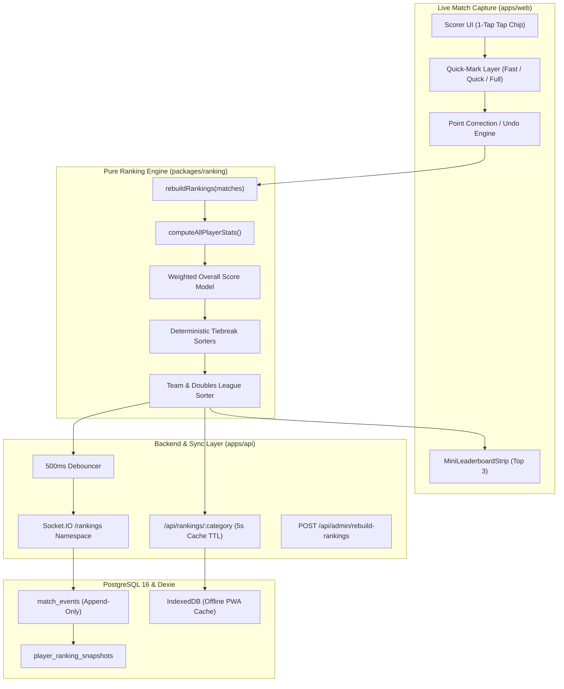
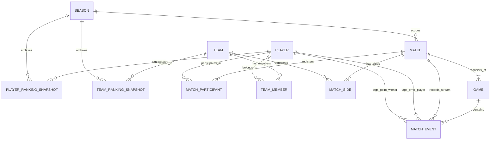

# RallyPoint Community Ranking & Team League System Documentation

> Complete technical documentation for the Community Ranking and Team League engine, mathematical projection models, event sourcing architecture, data dictionary, and fast scorer guide.

---

## 1. Executive Summary & Architecture

The **RallyPoint Community Ranking System** provides real-time leaderboards, team league standings, weekly accolades, and historical form analytics for local badminton clubs and competitive communities.

### Architectural Principles
1. **Pure Event Sourcing**: Leaderboards are never stored as mutable counters. Scores, wins, streaks, and shot breakdowns are derived pure projections replaying append-only domain events (`POINT`, `MATCH_END`, etc.).
2. **Deterministic Rebuild**: Any past score or rally tag correction can be safely applied; the entire leaderboard can be recomputed deterministically via `npm run rebuild-rankings` or the Admin API.
3. **Mandatory Transparency**: Every rank across all categories displays **`Matches: N`** alongside the rank position to prevent sample-size distortions.
4. **Standard BWF Compliance & Auto-Pairing**: Automatically detects doubles pairs, computes pair ratings, and auto-suggests balanced 4-player doubles matches.



---

## 2. Mathematical Ranking Formulas & Tiebreak Rules

### 2.1. The OVERALL Composite Index Formula

The overall ranking leaderboard is computed using a multi-factor normalized composite index:

$$\text{Index Score} = w_{\text{win}} \cdot \text{WinRate} + w_{\text{diff}} \cdot \text{PtDiffPerMatch} + w_{\text{wins}} \cdot \text{Wins} + w_{\text{form}} \cdot \text{Form} + w_{\text{cons}} \cdot \text{Consistency}$$

#### Default Weight Matrix (Configurable by Admin)
| Factor | Weight ($w_i$) | Normalization Base | Description |
| :--- | :---: | :--- | :--- |
| **Win Rate** | `0.40` | `0.0` to `100.0%` | Ratio of matches won to matches played. |
| **Point Difference** | `0.25` | `(PtDiff / Matches) * 2` | Net rally points scored minus conceded per match. |
| **Wins Volume** | `0.15` | `Wins * 5` | Reward for high participation and active match volume. |
| **Current Form** | `0.10` | `Last 5 Matches (W=1.0, L=0.0) * 100` | Exponentially-weighted recent results. |
| **Consistency** | `0.10` | $\max(0, 100 - \sigma_{\text{pts}} \cdot 5)$ | Low game-to-game scoring volatility. |

*Note: For players below the configurable minimum matches threshold (default: 5 matches), their composite score is scaled by $\frac{N}{\text{MinMatches}}$ to prevent one lucky win from seizing top spot.*

---

### 2.2. Deterministic Tiebreak Cascade

When two or more players or teams share identical headline metrics, ties are broken strictly in the following order:

#### 1. Most Wins Leaderboard
1. Win Rate (percentage of matches won).
2. Net Point Difference (`Points Scored - Points Conceded`).
3. Direct Head-to-Head match outcome.
4. Total Matches Played (higher activity breaks tie).

#### 2. Most Points Scored
1. Points Per Match (`Total Points / Matches Played`).
2. Total Matches Won.
3. Net Point Difference.

#### 3. Most Losses (The Resilience Board)
1. Loss Rate (`Losses / Matches Played`).
2. Total Points Conceded (points dropped).
3. Inverse Win Rate.

#### 4. Most Drops (Played vs Conceded)
- **Drop Shots Played**: Total drop shot winners + Total drop shots rallied -> Fewest drop shot errors -> Win rate.
- **Points Dropped (Conceded)**: Total points conceded -> Points conceded per match -> Loss count.

#### 5. Most Unforced Errors ("Who Fails More")
1. Unforced Errors Per Match.
2. Total Unforced Errors.
3. Forced Errors Count.

#### 6. Best Win Rate
1. Minimum Match Threshold (default: 5 matches). Players with $< 5$ matches are filtered or partitioned into provisional ranks.
2. Net Point Difference Per Match.
3. Total Matches Played.

#### 7. Shared Ties Notation
Players with identical tiebreaker metrics share the same rank number (e.g., `1, 2, 2, 4`), and rank movements (`UP`, `DOWN`, `SAME`) are preserved relative to the previous official snapshot.

---

## 3. Team League & Auto-Detected Doubles Pairs

The team league tracks both **Fixed Pairs / Auto-Detected Doubles Pairs** and **Fixed Club Teams**.

### Metrics Tracked per Team
- **Matches Played (P)**
- **Wins (W)** & **Losses (L)**
- **Win Rate (Win%)**
- **Points For (PF)** & **Points Against (PA)**
- **Point Difference (+/-)**
- **Promotion / Relegation Cutoffs**:
  - Positions 1–2: Promotion Zone (`▲ PROMOTION`).
  - Positions 3–6: Mid-Table Safety (`− MID-TABLE`).
  - Positions 7+: Relegation Danger (`▼ RELEGATION`).

### Auto-Balanced Doubles Suggestion Algorithm
Given four selected community players with individual ratings $(R_1, R_2, R_3, R_4)$ sorted descending:
$$\text{Pair A} = (R_1, R_4) \quad \text{vs} \quad \text{Pair B} = (R_2, R_3)$$
$$\Delta_{\text{Balance}} = |(R_1 + R_4) - (R_2 + R_3)|$$
This pairing provably minimizes rating disparity and produces the most competitive community matches.

---

## 4. Entity Relationship Diagram (Mermaid)



---

## 5. Data Dictionary

### Core Tables & Enums

#### `seasons`
- `id` (UUID/cuid, PK): Unique season identifier.
- `name` (VARCHAR): e.g. "Spring 2026 Community Championship".
- `start_date` (TIMESTAMPTZ): Start timestamp.
- `end_date` (TIMESTAMPTZ, Nullable): Closing date.
- `is_active` (BOOLEAN): Active season flag for live projections.

#### `player_ranking_snapshots`
- `id` (UUID/cuid, PK): Snapshot unique ID.
- `player_id` (UUID, FK -> `players.id`): Ranked player.
- `season_id` (UUID, FK -> `seasons.id`): Associated season.
- `category` (VARCHAR): `OVERALL`, `MOST_WINS`, `MOST_POINTS`, `MOST_LOSSES`, `MOST_DROPS_PLAYED`, `MOST_DROPS_CONCEDED`, `MOST_UNFORCED_ERRORS`, `BEST_WIN_RATE`.
- `period` (VARCHAR): `SEASON`, `MONTH`, `WEEK`, `ALL_TIME`.
- `rank` (INT): 1-based leaderboard position.
- `previous_rank` (INT, Nullable): Position in previous snapshot for delta calculation.
- `matches_played` (INT): Total matches played at time of snapshot (**Matches: N**).
- `headline_value` (FLOAT): Main numeric metric.
- `stats` (JSONB): Full serialized `PlayerStats` snapshot.

#### `match_events` (Rally Tagging Extensions)
- `shot_type` (VARCHAR, Nullable): `SMASH`, `DROP`, `NET`, `CLEAR`, `DRIVE`, `LOB`, `SERVE`.
- `rally_end_result` (VARCHAR, Nullable): `WINNER`, `UNFORCED_ERROR`, `FORCED_ERROR`, `OUT`, `NET_FAULT`, `SERVICE_FAULT`.
- `point_winner_player_id` (UUID, Nullable): Attributed rally winner player.
- `error_player_id` (UUID, Nullable): Player committing error or fault.

---

## 6. Scorer User Guide: How to Mark Points Quickly

Scoring badminton rallies in real-time requires high-speed, zero-distraction interaction:

### The 3 Tagging Modes
1. **Fast Mode (`FAST`)**:
   - Zero extra taps.
   - Simply tap **Side A (+1)** or **Side B (+1)**. The engine credits the point to the side and server immediately.
2. **Quick Mode (`QUICK` - Recommended)**:
   - Tap point winner (+1).
   - An intuitive chip row appears for **3 seconds**:
     - *Shot Types*: `[💥 Smash] [🪶 Drop] [🕸️ Net] [🏸 Clear] [⚡ Drive]`
     - *Result*: `[🏆 Winner] [❌ Unforced Error]`
     - *Who*: Auto-suggests the rally winner or opponent.
   - Tap 1 chip if desired; if ignored, the chip row **auto-dismisses** without interrupting the game.
3. **Full Mode (`FULL`)**:
   - Mandatory modal for tournament matches and official academy training sessions. Requires shot type, outcome, and player attribution before advancing.

### Quick Point Correction & Undo
- Made a mistake? Tap **Undo** or click **"Point History / Edit"**.
- View the last 10 points played with their sequence, score, shot tag, and winner.
- Change the winner side, adjust shot type, or reattribute error with 1 tap.
- State is recomputed via pure event replay and live ranks update instantly.

---

## 7. API Reference

| Method | Endpoint | Description | Cache / Auth |
| :--- | :--- | :--- | :--- |
| `GET` | `/api/rankings/:category` | Paginated leaderboard for category | 5s TTL Cache, `Matches: N` |
| `GET` | `/api/rankings/player/:id` | Detailed player stats and rank history | Public |
| `GET` | `/api/rankings/head-to-head` | Compare two players direct record | Public (`?player1=&player2=`) |
| `GET` | `/api/teams/rankings` | Doubles pairs and club teams standings | 5s TTL Cache |
| `POST` | `/api/admin/rebuild-rankings` | Recomputes all rankings from raw events | Admin JWT (`ADMIN` role) |
| `POST` | `/api/admin/recalculate-streaks` | Recomputes current and best win streaks | Admin JWT (`ADMIN` role) |
| `GET` | `/api/admin/audit-log` | Audit history of past event modifications | Admin JWT (`ADMIN` role) |
| `POST` | `/api/admin/daily-rollup` | Creates daily snapshot and weekly awards | Admin JWT (`ADMIN` role) |

### WebSocket Live Sync
- **Namespace**: `/rankings`
- **Room**: Join room `live` or `season:<id>`
- **Event**: `rankings:update`
- **Payload**: Minimal diff containing only changed rows:
  ```json
  [
    {
      "playerId": "player-viktor",
      "category": "OVERALL",
      "oldRank": 2,
      "newRank": 1,
      "movement": "UP"
    }
  ]
  ```
